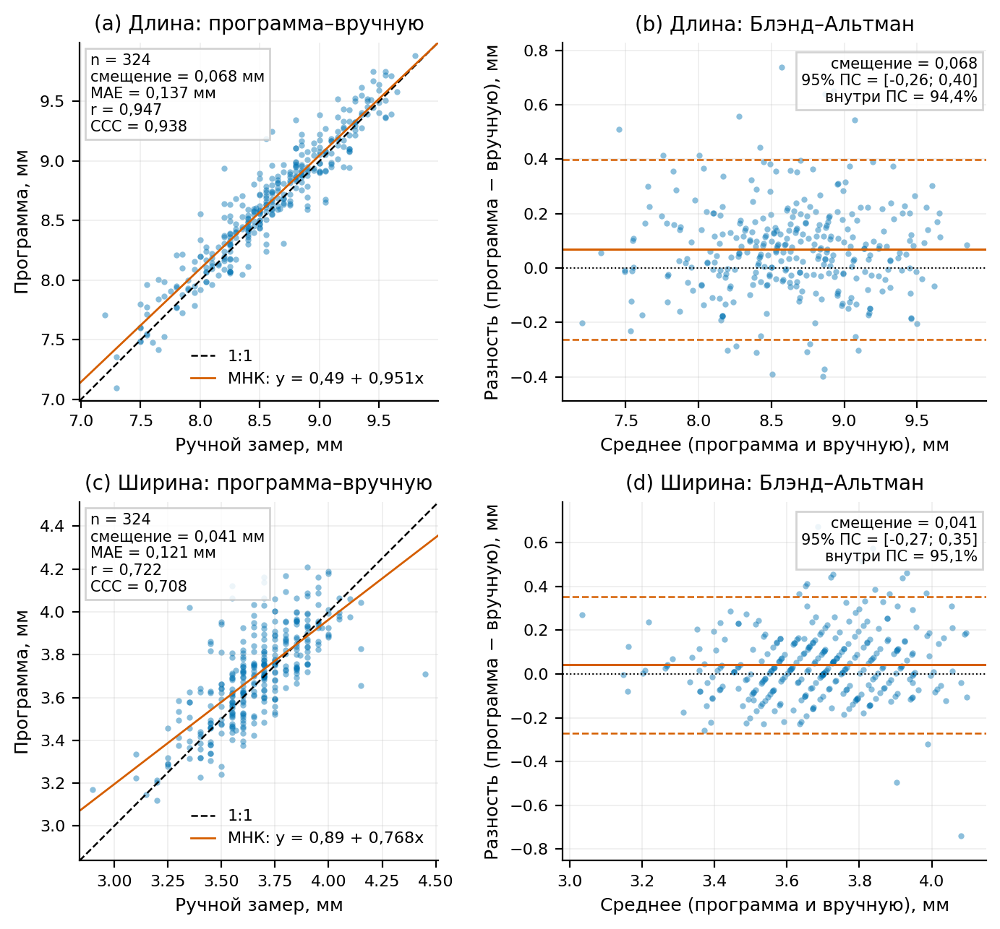
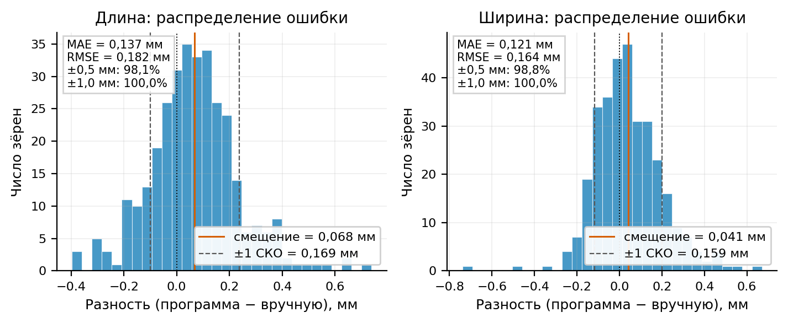
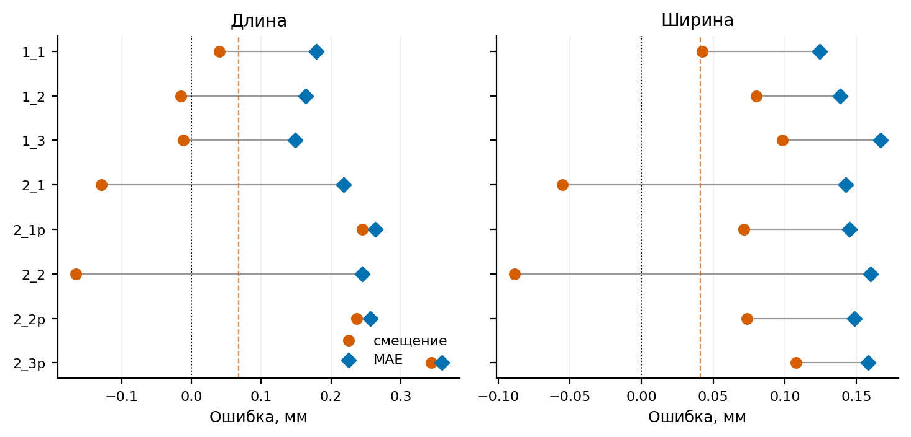

# Переработка геометрии зерна и автоматическая классификация формы

Дата: 2026-11-14. Набор: 8 снимков по 325 зёрен (2600 контуров).
Ручной эталон: `other/Ruchnye_zamery_zerna_po_ryadam.xlsx`,
подготовленный `results/manual_reference.csv` (325 записей; у зерна №275
отсутствует ручной замер, поэтому в сравнение входят 324 серии).

## 1. Новые определения

**Длина и ширина** строятся как перпендикулярный крест из двух оснований.

1. Самая длинная внутренняя хорда контура задаёт первое основание длины.
   Максимальная внутренняя хорда, перпендикулярная ей, задаёт первое основание
   ширины.
2. От основания ширины, в свою очередь, ищется перпендикулярная максимальная
   хорда — второе основание длины. От неё ищется перпендикулярная максимальная
   хорда — второе основание ширины.
3. Итоговые концы длины — средние соответствующих концов двух оснований длины;
   итоговые концы ширины — средние соответствующих концов двух оснований
   ширины. Перед усреднением концы упорядочиваются в одном направлении.

Оба основания длины параллельны, оба основания ширины тоже параллельны,
поэтому усреднённые отрезки остаются строго перпендикулярными. На всех 2600
контурах максимальное |cos| угла между итоговыми отрезками составило
`4.3e-16`, то есть отклонение от 90° лежит в пределах машинной точности.

Каждая базовая хорда — максимальный отрезок между двумя точками контура,
целиком лежащий внутри контура. Для ширины на 192 положениях вдоль оси
строятся перпендикулярные прямые, находятся все пересечения с рёбрами
полигона, дубликаты в вершинах объединяются, а пересечения разбиваются на пары
«вход–выход». Максимальный внутренний интервал по всем положениям и есть
ширина. Эллипсы, `minAreaRect`, площадь hull и усреднение по площади не
используются.

Итоговый усреднённый отрезок ширины отличается от максимальной внутренней
перпендикулярной хорды не более чем на 0.021 px. После краевой поправки
(см. ниже) его концы дополнительно смещены внутрь контура на
`edge_width_px / 2`, поэтому за контур они не выходят.

Замер выполняется в локальной системе координат (вычитается первая точка
контура). Это делает результат трансляционно-инвариантным: контуры в JSON
хранятся в координатах кропа, а пакетный конвейер измеряет их в координатах
исходного снимка. Без нормализации сдвиг иногда менял метку формы на границе
шаблонов; теперь CSV и инспектор дают одинаковые `length_px`, `width_px`,
`angle_deg` и `shape` на всех 2600 контурах (проверено по каждому JSON,
с учётом `edge_width_px`).

### Поправка на краевую полосу

Бинарный контур Otsu проходит по внешней стороне перехода «фон–зерно».
Функция `estimate_edge_width` измеряет ширину этого перехода по уровням
80 → 20 %, поэтому физическая граница зерна лежит примерно на половину
этой ширины внутри контура.

В `measure_contour_geometry` оба итоговых отрезка симметрично
укорачиваются на `edge_width_px / 2` с каждого конца, то есть на одну
полную ширину края. Поправка персональная для каждого зерна, не меняет
направление отрезков и применяется только при наличии оценки края
(`edge_width_px`); для контура без неё замер остаётся прежним.

Форма классифицируется по исходному (внешнему) профилю: шаблоны
калибровались на нём, а краевая поправка — почти постоянный сдвиг ширины,
не меняющий относительную форму профиля.

Реализация: `src/core/seed_geometry.py`
(`_longest_internal_chord`, `maximum_internal_width`,
`_shrink_chord`, `measure_contour_geometry`). Экспорт: `src/core/export.py`,
`DEFAULT_CSV_FIELDS` в `src/core/models.py`.

## 2. Сравнение с ручным эталоном

Сравнение по среднему из 8 снимков для каждой серии, n = 324 (без №275).

| Параметр | Версия | Смещение, мм | MAE, мм | RMSE, мм | r | CCC | Программа, мм | Ручной, мм |
|---|---|---:|---:|---:|---:|---:|---:|---:|
| Длина | крест, без поправки | +0.3396 | 0.3409 | 0.3746 | 0.9528 | 0.7827 | 8.9342 | 8.5947 |
| Длина | крест + поправка края | +0.0680 | 0.1370 | 0.1815 | 0.9467 | 0.9385 | 8.6627 | 8.5947 |
| Ширина | старая (hull/L) | −0.7855 | 0.7855 | 0.8022 | 0.6356 | 0.0634 | 2.8791 | 3.6646 |
| Ширина | макс. хорда, без поправки | +0.3128 | 0.3171 | 0.3580 | 0.6861 | 0.3367 | 3.9774 | 3.6646 |
| Ширина | макс. хорда + поправка края | +0.0412 | 0.1210 | 0.1644 | 0.7223 | 0.7076 | 3.7058 | 3.6646 |

Поправка на краевую полосу — главный источник улучшения. Смещение длины
уменьшается с +0.340 до +0.068 мм (в 5 раз), ширины — с +0.313 до
+0.041 мм (в 7.6 раза). MAE падает с 0.341 до 0.137 мм для длины и с
0.317 до 0.121 мм для ширины; CCC растёт с 0.783 до 0.938 и с 0.337 до
0.708. Остаток +0.04…+0.07 мм лежит в пределах повторяемости ручного
замера (цена деления 0.05 мм плюс ошибка оператора ~0.05–0.1 мм).

До поправки схема креста сама по себе давала лишь сотые доли миллиметра:
второе основание длины параллельно первому, поэтому усреднение сдвигает
концы на доли пикселя (максимум 0.139 px по длине и 0.044 px по ширине).
Главный выигрыш креста — гарантированная перпендикулярность и готовые
концы отрезков для визуализации.

После снятия краевой составляющей остаётся более слабая масштабно-
позиционная составляющая. Она видна по снимкам: смещение длины гуляет
от −0.17 до +0.34 мм, тогда как ширина держится в пределах ±0.11 мм.

По снимкам после поправки:

| Снимок | Длина: смещение, мм | Длина: MAE, мм | Ширина: смещение, мм | Ширина: MAE, мм |
|---|---:|---:|---:|---:|
| 1_1 | +0.040 | 0.179 | +0.042 | 0.124 |
| 1_2 | −0.015 | 0.164 | +0.080 | 0.139 |
| 1_3 | −0.012 | 0.148 | +0.098 | 0.167 |
| 2_1 | −0.129 | 0.218 | −0.055 | 0.142 |
| 2_1p | +0.245 | 0.263 | +0.071 | 0.145 |
| 2_2 | −0.166 | 0.245 | −0.089 | 0.160 |
| 2_2p | +0.237 | 0.257 | +0.074 | 0.149 |
| 2_3p | +0.344 | 0.359 | +0.108 | 0.158 |

Длина систематически завышена на P-снимках (`2_1p`, `2_2p`, `2_3p`) и
занижена на `2_1`/`2_2`. Это согласуется с разбросом масштаба, который
даёт автокалибровка по линейке (0.977…1.048 по снимкам), и с ракурсом;
ширина после поправки практически не зависит от снимка.

### Новые графики по текущим данным

Скрипт `results/figures_cross.py` пересчитывает все метрики напрямую из
`out/seeds.csv` и `results/manual_reference.csv`, не используя устаревшие
таблицы `results/tables`. Метрики сохраняются в
`results/geometry_agreement_current.csv`.

После краевой поправки по сравнению с версией до неё
(`out/seeds_before_edge_fix.csv`) `length_px` и `width_px` изменились
во всех 2600 строках ровно на `edge_width_px` (с точностью до округления
CSV; максимум 7.653 px). `angle_deg`, `area_px`, `edge_width_px`,
`status`, `shape` и `color_hex` совпали по всем строкам. `mm_per_px`
пересчитался при повторном прогоне (отличие не более 2×10⁻⁶),
`has_groove` переключился у 5 пограничных зёрен.

## 3. Классы формы и обоснование шаблонов

Три прикладных класса не являются стандартными ботаническими терминами; они
сопоставлены с литературным описанием морфологии зерновки ячменя:

* основные ботанические формы — ромбическая, эллиптическая и удлинённая;
* зерновка эллиптическая, с продольной неглубокой бороздкой, заострена с обеих
  сторон;
* у удлинённой формы наиболее широкая часть расположена несколько выше
  середины, а сужение кверху резче, чем книзу.

Источники:

* «Строение и свойства зерновки ячменя» —
  <https://www.activestudy.info/stroenie-i-svojstva-zernovki-yachmenya/>;
* БГСХА, «Сортовые признаки ячменя» (методические материалы, раздел о форме
  зерновки).

Отсюда шаблоны нормированного профиля ширины вдоль длинной оси:

* **грушевидная** — асимметричный профиль: максимум смещён к одному концу,
  к противоположному концу сужение резче (соответствует удлинённой форме с
  максимумом выше середины);
* **цилиндрическая** — симметричный профиль с выровненной серединой и
  округлыми концами (соответствует эллиптической/ромбической форме);
* **игольчатая** — удлинённое зерно с узким профилем и заострёнными концами
  (соответствует сильнее вытянутой удлинённой форме).

Классификатор сравнивает профиль ширины с тремя шаблонами по среднему
абсолютному отклонению. Шаблон грушевидной формы проверяется в обоих
направлениях оси. Дополнительные приоры: игольчатая форма требует
L/W ≥ 2.40 и не слишком «плоского» профиля, грушевидная — асимметрии ≥ 1.36.
Пороги взяты по распределению 2600 контуров (около 90-го процентиля).
Константы и шаблоны: `SHAPE_*`, `_SHAPE_TEMPLATE_ANCHORS`,
`classify_seed_shape` в `src/core/seed_geometry.py`.

Распределение по 2600 контурам:

| Класс | Контуров | Доля | Серий (мода по 8 снимкам) |
|---|---:|---:|---:|
| грушевидная | 1610 | 61.9 % | 219 |
| цилиндрическая | 764 | 29.4 % | 85 |
| игольчатая | 226 | 8.7 % | 21 |

Согласованность метки для одного и того же зерна на 8 снимках: полностью
совпадает у 183 из 325 серий (56.3 %), не менее 6 из 8 — у 256 (78.8 %),
средняя доля модальной метки 0.873, Fleiss κ = 0.631. Меньшая согласованность
характерна для P-снимков (`2_1p`, `2_2p`, `2_3p`), что указывает на влияние
ракурса/освещения на профиль, а не на разную форму зерна.

## 4. Интерфейс инспекции

В `src/gui/inspection_app.py`:

* выпадающий список формы содержит ровно три значения: `грушевидная`,
  `цилиндрическая`, `игольчатая`, список только для чтения;
* при загрузке контура, его изменении и сохранении автоматически
  пересчитываются `length_px`, `width_px`, `angle_deg` и `shape`;
* пересчёт использует сохранённый `edge_width_px`, поэтому после краевой
  поправки значения совпадают с CSV;
* произвольные значения формы больше не добавляются в список.

В `src/gui/aug_inspection_app.py`:

* добавлен переключатель «Отрезок ширины» (включён по умолчанию);
* ширина рисуется пурпурной линией с белыми маркерами на концах поверх
  контура; концы берутся из `measure_contour_geometry` по загруженному
  контуру, поэтому отрезок корректен и для аугментированных копий;
* геометрия пересчитывается при каждой смене кадра с тем же `edge_width_px`,
  что и в CSV, поэтому отрезок ширины совпадает с сохранённым замером.

## 5. Что осталось обновить

`results/main.tex` и `results/short_report.tex` описывают прежнюю методику
(ширина как средняя хорда `площадь/длина` и отношение π/4). После перехода на
максимальную внутреннюю хорду эти разделы и соответствующие рисунки/таблицы
нужно переписать; `results/analysis.py` в части `width_ratio` также ещё
проверяет старую гипотезу π/4, а `results/analysis_report.txt` содержит
метрики до краевой поправки. Снимок `results/seeds_final.csv` не обновлялся
и содержит старую геометрию без столбца `shape`.

Отдельно остаётся масштабно-позиционная составляющая: автокалибровка по
линейке даёт разброс 0.977…1.048 по снимкам, из-за чего смещение длины на
отдельных снимках достигает ±0.3 мм. Это задача калибровки/ракурса, не
связанная с краевой поправкой.
