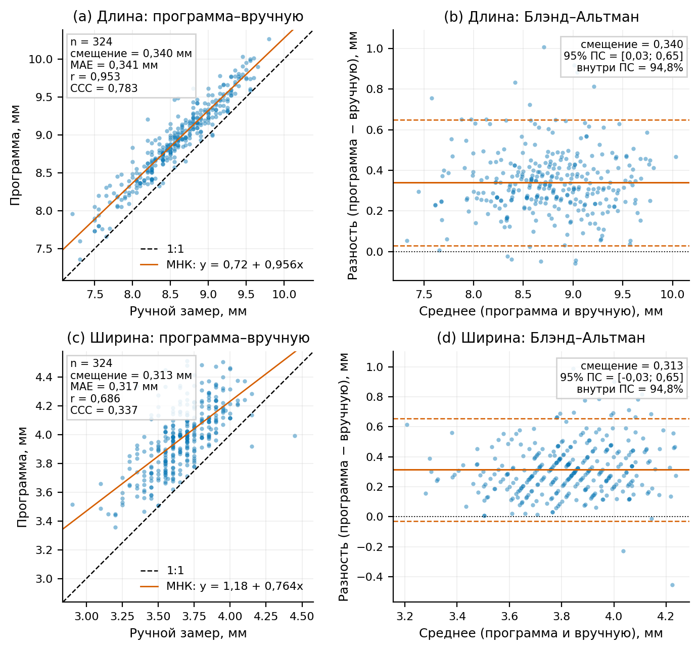
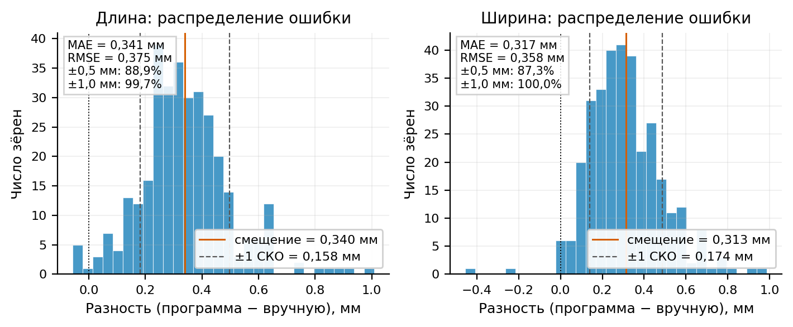
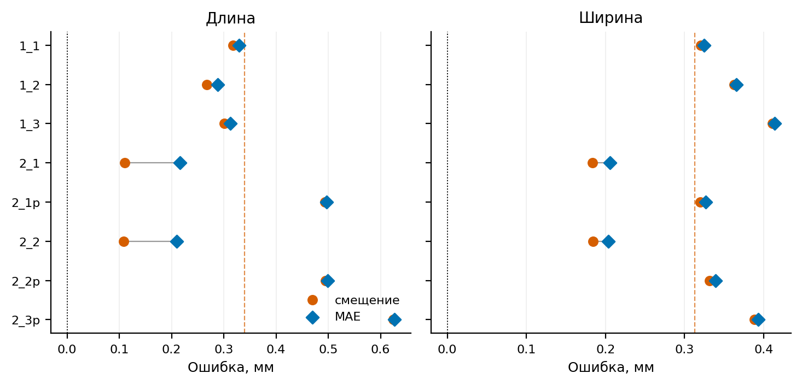

# Переработка геометрии зерна и автоматическая классификация формы

Дата: 2026-11-14. Набор: 8 снимков по 325 зёрен (2600 контуров).
Ручной эталон: `other/Ruchnye_zamery_zerna_po_ryadam.xlsx`,
подготовленный `results/manual_reference.csv` (325 записей; у зерна №275
отсутствует ручной замер, поэтому в сравнение входят 324 серии).

## 1. Новые определения

**Длина и ширина** строятся как перпендикулярный крест из двух оснований.

1. Самая длинная внутренняя хорда контура задаёт первое основание длины.
   Максимальная внутренняя хорда, перпендикулярная ей, задаёт первое основание
   ширины.
2. От основания ширины, в свою очередь, ищется перпендикулярная максимальная
   хорда — второе основание длины. От неё ищется перпендикулярная максимальная
   хорда — второе основание ширины.
3. Итоговые концы длины — средние соответствующих концов двух оснований длины;
   итоговые концы ширины — средние соответствующих концов двух оснований
   ширины. Перед усреднением концы упорядочиваются в одном направлении.

Оба основания длины параллельны, оба основания ширины тоже параллельны,
поэтому усреднённые отрезки остаются строго перпендикулярными. На всех 2600
контурах максимальное |cos| угла между итоговыми отрезками составило
`4.3e-16`, то есть отклонение от 90° лежит в пределах машинной точности.

Каждая базовая хорда — максимальный отрезок между двумя точками контура,
целиком лежащий внутри контура. Для ширины на 192 положениях вдоль оси
строятся перпендикулярные прямые, находятся все пересечения с рёбрами
полигона, дубликаты в вершинах объединяются, а пересечения разбиваются на пары
«вход–выход». Максимальный внутренний интервал по всем положениям и есть
ширина. Эллипсы, `minAreaRect`, площадь hull и усреднение по площади не
используются.

Итоговый усреднённый отрезок ширины отличается от максимальной внутренней
перпендикулярной хорды не более чем на 0.021 px. Из-за пиксельной
дискретизации его концы в редких случаях выходят за контур: в 99.65 %
контуров — не более чем на 0.5 px, в единственном контуре — на 1.5 px
(менее 0.1 мм в пересчёте на калибровку), поэтому на замер это не влияет.

Замер выполняется в локальной системе координат (вычитается первая точка
контура). Это делает результат трансляционно-инвариантным: контуры в JSON
хранятся в координатах кропа, а пакетный конвейер измеряет их в координатах
исходного снимка. Без нормализации сдвиг иногда менял метку формы на границе
шаблонов; теперь CSV и инспектор дают одинаковые `length_px`, `width_px`,
`angle_deg` и `shape` на всех 2600 контурах (проверено по каждому JSON).

Реализация: `src/core/seed_geometry.py`
(`_longest_internal_chord`, `maximum_internal_width`,
`measure_contour_geometry`). Экспорт: `src/core/export.py`,
`DEFAULT_CSV_FIELDS` в `src/core/models.py`.

## 2. Сравнение с ручным эталоном

Сравнение по среднему из 8 снимков для каждой серии, n = 324 (без №275).

| Параметр | Версия | Смещение, мм | MAE, мм | RMSE, мм | r | CCC | Программа, мм | Ручной, мм |
|---|---|---:|---:|---:|---:|---:|---:|---:|
| Длина | макс. внутренняя хорда | +0.3419 | 0.3432 | 0.3767 | 0.9529 | 0.7808 | 8.9366 | 8.5947 |
| Длина | крест из двух баз (итог) | +0.3396 | 0.3409 | 0.3746 | 0.9528 | 0.7827 | 8.9342 | 8.5947 |
| Ширина | старая (hull/L) | −0.7855 | 0.7855 | 0.8022 | 0.6356 | 0.0634 | 2.8791 | 3.6646 |
| Ширина | новая (макс. хорда) | +0.3128 | 0.3171 | 0.3580 | 0.6861 | 0.3367 | 3.9774 | 3.6646 |

Крест из двух оснований дал небольшое улучшение длины: смещение
+0.3419 → +0.3396 мм, MAE 0.3432 → 0.3409 мм, RMSE 0.3767 → 0.3746 мм,
CCC 0.7808 → 0.7827. Ширина не изменилась. Причина в том, что второе
основание длины параллельно первому, поэтому усреднение сдвигает концы лишь
на доли пикселя: максимальное изменение длины относительно версии с одной
максимальной хордой — 0.139 px (около 0.009 мм), ширины — 0.044 px. Главный
выигрыш схемы — гарантированная перпендикулярность и готовые концы обоих
отрезков для визуализации, а не прирост точности.

Смещение ширины уменьшилось по модулю с 0.786 до 0.313 мм, MAE — с 0.786 до
0.317 мм, корреляция выросла с 0.636 до 0.686, CCC — с 0.063 до 0.337.
Остаточное превышение +0.31 мм (около 8.5 %) может объясняться дилатацией
контура при сегментации, калибровкой по линейке и отличием протокола ручного
замера; это не скрывается.

По снимкам новая ширина также лучше старой во всех восьми случаях:

| Снимок | Смещение старой, мм | Смещение новой, мм | MAE старой | MAE новой | r старой | r новой |
|---|---:|---:|---:|---:|---:|---:|
| 1_1 | −0.779 | +0.321 | 0.779 | 0.325 | 0.633 | 0.684 |
| 1_2 | −0.743 | +0.363 | 0.743 | 0.366 | 0.600 | 0.649 |
| 1_3 | −0.703 | +0.411 | 0.703 | 0.414 | 0.519 | 0.576 |
| 2_1 | −0.895 | +0.184 | 0.895 | 0.205 | 0.674 | 0.700 |
| 2_1p | −0.777 | +0.320 | 0.777 | 0.327 | 0.611 | 0.653 |
| 2_2 | −0.899 | +0.185 | 0.899 | 0.203 | 0.658 | 0.696 |
| 2_2p | −0.768 | +0.332 | 0.768 | 0.339 | 0.567 | 0.623 |
| 2_3p | −0.721 | +0.388 | 0.721 | 0.393 | 0.558 | 0.635 |

### Новые графики по текущим данным

Скрипт `results/figures_cross.py` пересчитывает все метрики напрямую из
`out/seeds.csv` и `results/manual_reference.csv`, не используя устаревшие
таблицы `results/tables`. Метрики сохраняются в
`results/geometry_agreement_current.csv`.

При повторном пакетном прогоне по сравнению с версией до креста
(`out/seeds_before_cross.csv`) изменились только геометрические поля:
`length_px` — в 2560 строках (не более 0.139 px), `width_px` — в 187 строках
(не более 0.044 px), `shape` — в 12 строках. `angle_deg`, `area_px`,
`edge_width_px`, `mm_per_px`, `status`, `color_hex`, `has_groove` совпали
по всем 2600 строкам. Относительно более ранней резервной копии
`out/seeds_before_geometry.csv` добавлен столбец `shape`.

## 3. Классы формы и обоснование шаблонов

Три прикладных класса не являются стандартными ботаническими терминами; они
сопоставлены с литературным описанием морфологии зерновки ячменя:

* основные ботанические формы — ромбическая, эллиптическая и удлинённая;
* зерновка эллиптическая, с продольной неглубокой бороздкой, заострена с обеих
  сторон;
* у удлинённой формы наиболее широкая часть расположена несколько выше
  середины, а сужение кверху резче, чем книзу.

Источники:

* «Строение и свойства зерновки ячменя» —
  <https://www.activestudy.info/stroenie-i-svojstva-zernovki-yachmenya/>;
* БГСХА, «Сортовые признаки ячменя» (методические материалы, раздел о форме
  зерновки).

Отсюда шаблоны нормированного профиля ширины вдоль длинной оси:

* **грушевидная** — асимметричный профиль: максимум смещён к одному концу,
  к противоположному концу сужение резче (соответствует удлинённой форме с
  максимумом выше середины);
* **цилиндрическая** — симметричный профиль с выровненной серединой и
  округлыми концами (соответствует эллиптической/ромбической форме);
* **игольчатая** — удлинённое зерно с узким профилем и заострёнными концами
  (соответствует сильнее вытянутой удлинённой форме).

Классификатор сравнивает профиль ширины с тремя шаблонами по среднему
абсолютному отклонению. Шаблон грушевидной формы проверяется в обоих
направлениях оси. Дополнительные приоры: игольчатая форма требует
L/W ≥ 2.40 и не слишком «плоского» профиля, грушевидная — асимметрии ≥ 1.36.
Пороги взяты по распределению 2600 контуров (около 90-го процентиля).
Константы и шаблоны: `SHAPE_*`, `_SHAPE_TEMPLATE_ANCHORS`,
`classify_seed_shape` в `src/core/seed_geometry.py`.

Распределение по 2600 контурам:

| Класс | Контуров | Доля | Серий (мода по 8 снимкам) |
|---|---:|---:|---:|
| грушевидная | 1610 | 61.9 % | 219 |
| цилиндрическая | 764 | 29.4 % | 85 |
| игольчатая | 226 | 8.7 % | 21 |

Согласованность метки для одного и того же зерна на 8 снимках: полностью
совпадает у 183 из 325 серий (56.3 %), не менее 6 из 8 — у 256 (78.8 %),
средняя доля модальной метки 0.873, Fleiss κ = 0.631. Меньшая согласованность
характерна для P-снимков (`2_1p`, `2_2p`, `2_3p`), что указывает на влияние
ракурса/освещения на профиль, а не на разную форму зерна.

## 4. Интерфейс инспекции

В `src/gui/inspection_app.py`:

* выпадающий список формы содержит ровно три значения: `грушевидная`,
  `цилиндрическая`, `игольчатая`, список только для чтения;
* при загрузке контура, его изменении и сохранении автоматически
  пересчитываются `length_px`, `width_px`, `angle_deg` и `shape`;
* произвольные значения формы больше не добавляются в список.

В `src/gui/aug_inspection_app.py`:

* добавлен переключатель «Отрезок ширины» (включён по умолчанию);
* ширина рисуется пурпурной линией с белыми маркерами на концах поверх
  контура; концы берутся из `measure_contour_geometry` по загруженному
  контуру, поэтому отрезок корректен и для аугментированных копий;
* геометрия пересчитывается при каждой смене кадра, отображение не зависит от
  полей `width_px`/`width_mm` в CSV.

## 5. Что осталось обновить

`results/main.tex` и `results/short_report.tex` описывают прежнюю методику
(ширина как средняя хорда `площадь/длина` и отношение π/4). После перехода на
максимальную внутреннюю хорду эти разделы и соответствующие рисунки/таблицы
нужно переписать; `results/analysis.py` в части `width_ratio` также ещё
проверяет старую гипотезу π/4. Снимок `results/seeds_final.csv` не обновлялся
и содержит старую геометрию без столбца `shape`.
